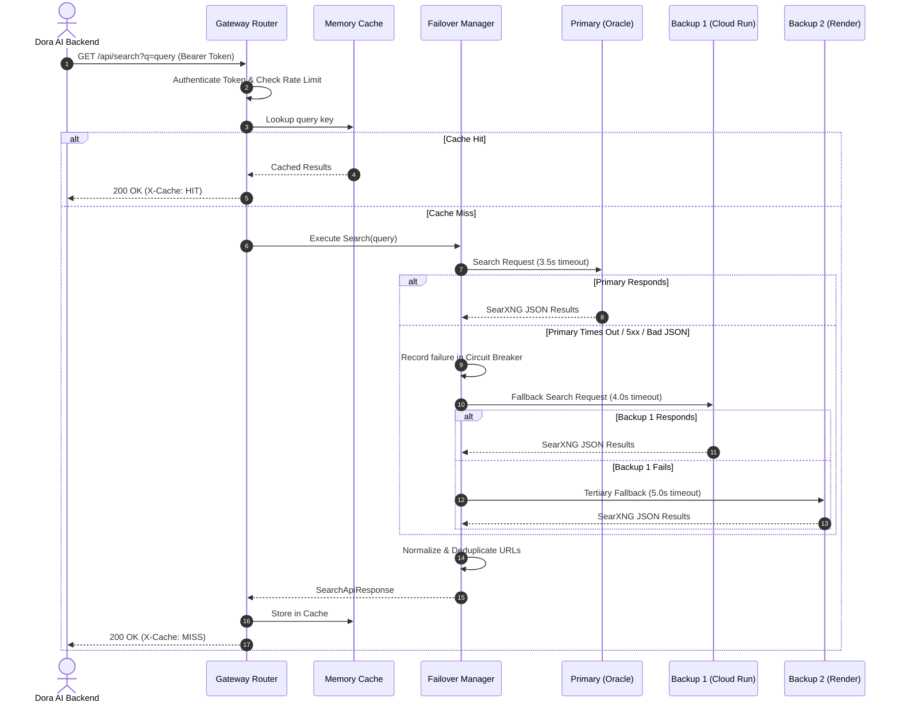

# Dora Search — Architecture Documentation

## 1. System Overview

Dora Search is an independent, resilient web search infrastructure engineered for Dora AI. It is completely decoupled from Dora's core agent logic, providing a clean JSON REST API, multi-cloud redundancy across free hosting tiers, automatic failover with circuit breakers, and an SSRF-protected webpage reader.

```
+-----------------------------------------------------------------------------------+
|                                  Dora AI Agent                                   |
|                          (Node.js / TypeScript Core)                              |
+-----------------------------------------------------------------------------------+
                                          |
                                          | HTTPS (Bearer Token Auth)
                                          v
+-----------------------------------------------------------------------------------+
|                            Cloudflare Worker Gateway                              |
|                                                                                   |
|  - Bearer Token & API Key Authentication                                          |
|  - Sliding-Window Rate Limiting (per IP)                                         |
|  - In-Memory LRU Query Cache (TTL configurable)                                   |
|  - Status & Diagnostics Dashboard (/dashboard)                                   |
|  - Sequential Failover Manager with Circuit Breakers                             |
+-----------------------------------------------------------------------------------+
       |                                  |                                  |
       | 1. Primary (Try First)           | 2. Backup 1 (On Failure)        | 3. Backup 2 (Emergency)
       v                                  v                                  v
+----------------------+       +----------------------+       +----------------------+
|  Oracle Cloud Free   |       |   Google Cloud Run   |       |     Render Free      |
|  (Always Free VM)    |       |   (Serverless Cont)  |       |   (Fallback Cont)    |
|                      |       |                      |       |                      |
|  - Caddy SSL + Auth  |       |  - SearXNG Cont.     |       |  - SearXNG Cont.     |
|  - SearXNG Container |       |  - Scale to zero     |       |  - 512MB RAM budget  |
|  - Valkey Cache &    |       |  - Max 1 instance    |       |  - Cold start backup |
|    Rate Limiting     |       |  - Keyless engines   |       |  - Keyless engines   |
+----------------------+       +----------------------+       +----------------------+
       |                                  |                                  |
       +----------------------------------+----------------------------------+
                                          |
                                          v Upstream Keyless Search Queries
                      +---------------------------------------+
                      | Keyless Search Engines:                |
                      | - DuckDuckGo  - Brave     - Qwant     |
                      | - Startpage   - Wikipedia - Wikidata  |
                      +---------------------------------------+
```

---

## 2. Component Design

### A. SearXNG Core Search Engine
SearXNG runs as the metasearch aggregator:
- **Pinned Docker Image**: `searxng/searxng:2025.2.22-3715d0ec3` (avoids unexpected breaking changes from `:latest`).
- **Valkey Caching**: `valkey/valkey:8.0.2-alpine` handles engine result caching, IP limiting, and query throttling.
- **Engine Selection**: Exclusively keyless engines (`duckduckgo`, `brave`, `qwant`, `startpage`, `wikipedia`, `wikidata`). Paid engines (`google`, `bing`) are disabled to eliminate API key dependencies and scraping captchas.
- **JSON Enabled**: `search.formats: [html, json]` is enabled for machine-readable JSON payloads.

### B. Gateway Router (`src/gateway/router.ts`)
The Gateway acts as the unified reverse proxy:
- Runs in **Cloudflare Workers** (edge) or as a **Standalone Node.js HTTP Service**.
- Built on standard Web Fetch APIs (`Request`, `Response`, `Headers`, `AbortController`).
- Implements constant-time timing-safe token authentication.
- Implements sliding-window rate limiting per client IP.
- Enforces payload size limits (max 2MB) to prevent memory DoS.

### C. Failover Manager (`src/failover/failover-manager.ts`)
The Failover Manager orchestrates calls across hosting targets:
- **Priority Order**:
  1. Primary: Oracle Cloud Always Free
  2. Backup 1: Google Cloud Run
  3. Backup 2: Render Free
- **Sequential Execution**: Queries are routed to the primary origin first; subsequent origins are called *only* if the preceding origin fails or times out. Providers are never queried simultaneously.
- **Circuit Breaker**:
  - `CLOSED`: Normal traffic.
  - `OPEN`: Triggered when an origin accumulates 3 consecutive failures. Traffic skips this origin immediately with zero latency penalty.
  - `HALF_OPEN`: After a cooldown period (default 30 seconds), a single probe query is permitted. If successful, state resets to `CLOSED`; if failed, state returns to `OPEN`.
- **Empty Result Detection**: If the primary origin returns 0 results for a non-empty query, failover triggers to query backup origins.
- **URL Deduplication**: Strips tracking tokens (`utm_*`, `fbclid`, `gclid`), normalizes ports/protocols, and merges richer metadata.

### D. Webpage Reader (`src/reader/webpage-reader.ts`)
A dedicated module for retrieving and parsing search destination articles:
- **SSRF Prevention**: All target URLs and redirect destinations are validated against private IPv4 (`10.0.0.0/8`, `172.16.0.0/12`, `192.168.0.0/16`, `127.0.0.0/8`, `169.254.0.0/16`) and IPv6 ranges (`::1`, `fc00::/7`, `fe80::/10`, IPv4-mapped IPv6).
- **DNS Rebinding Guard**: Hostnames are resolved to IP before fetching, and re-validated on every redirect hop (up to 5 redirects).
- **Stream Throttling**: Streams chunks directly from native `fetch`, terminating immediately if body exceeds `maxBytes` (default 2MB).
- **Clean Article Text**: Strips `<script>`, `<style>`, `<nav>`, `<noscript>`, `<footer>`, `<form>`, and `<aside>` without executing JavaScript.

---

## 3. Data Flow Diagram



